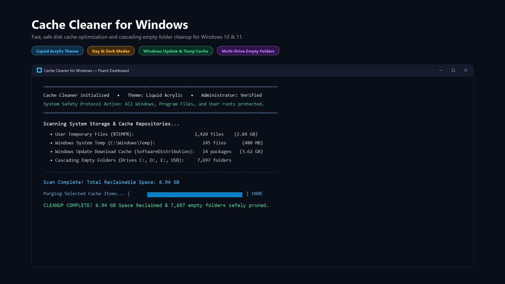
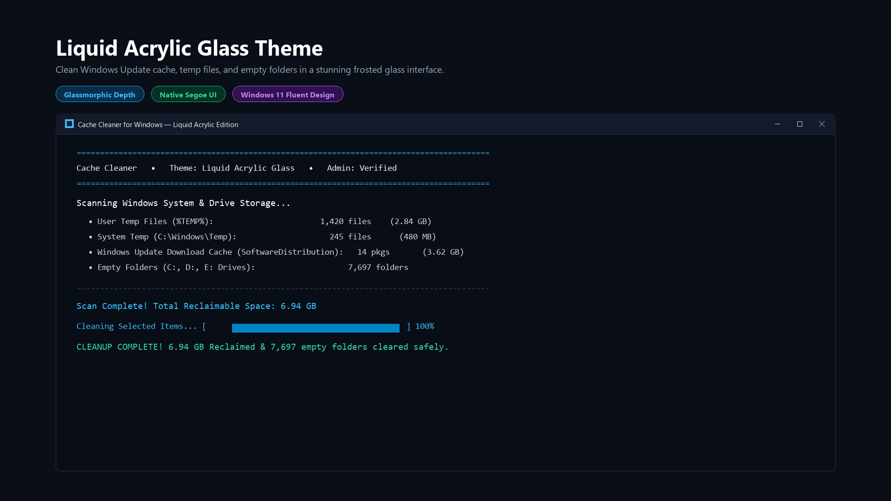
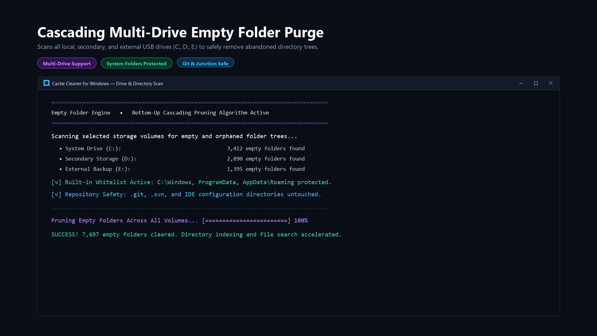
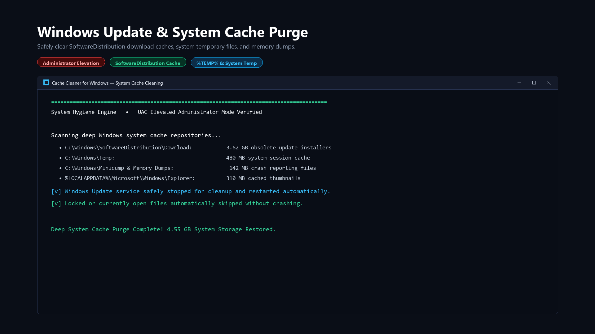
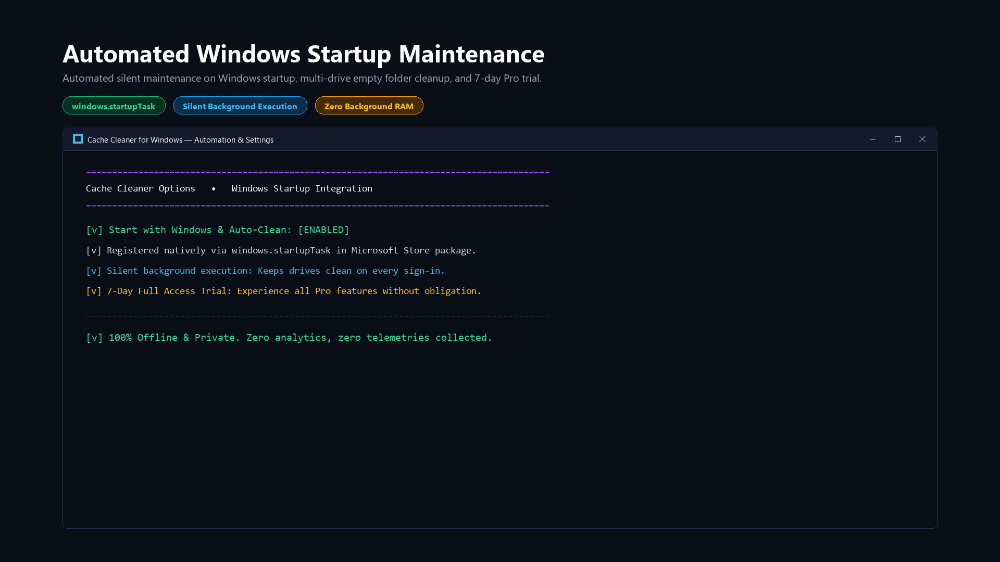
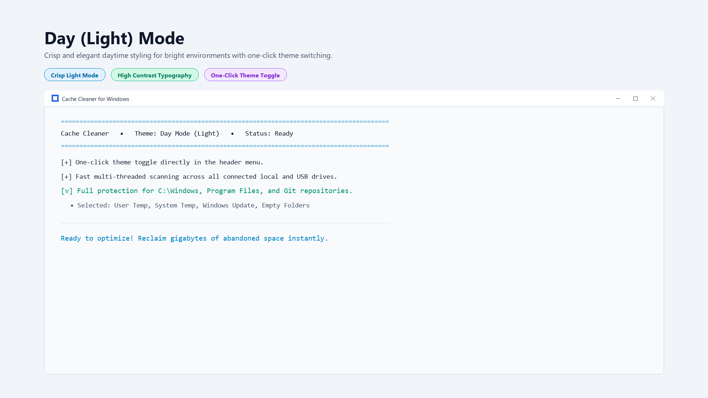

# 🧹 Cache Cleaner for Windows

**A fast, modern, and safe disk cache optimizer and cascading empty folder cleaner designed for Windows 10 & 11.**

[👉 Get it on the Microsoft Store](https://apps.microsoft.com/detail/9NFBVLGHCXGF?hl=en-us&gl=US) • [Features](#-key-features) • [Screenshots](#-screenshots-showcase) • [Safety Protocol](#-system-safety-protocol) • [Themes](#-modern-themes) • [FAQ](#-faq)

---

## 📸 Screenshots Showcase

### 1. Fluent Windows 11 Dashboard & Live Storage Metrics

### 2. Liquid Acrylic Glass Theme with Windows 11 Fluent Design

### 3. Cascading Multi-Drive Empty Folder Purge (C:, D:, E:, USB)

### 4. Deep Windows Update & System Temporary Cache Purge

### 5. Automated Windows Startup Maintenance & Hygiene

### 6. Crisp Day (Light) Mode for High-Ambient Environments

---

## ⚡ Key Features

Reclaim gigabytes of lost storage, eliminate sluggish drive indexing, and restore your PC's responsiveness without complex settings or dangerous registry cleaners.

- 🚀 **High-Speed Cache Cleaning:**
  - Instantly purge accumulated user temporary files (`%TEMP%`), Windows system temporary files (`C:\Windows\Temp`), error crash dumps (`Minidump`), and thumbnail caches.
  - Reclaim gigabytes of stranded disk space from obsolete Windows Update download packages (`SoftwareDistribution\Download`).

- 📂 **Cascading Empty Folder Engine:**
  - Scans across internal and external storage volumes (C:, D:, E:, and USB drives) simultaneously.
  - Employs a robust bottom-up cascading tree pruning algorithm that eliminates deep nested empty folders while accelerating Windows Search and drive indexing.

- 🛡️ **Bulletproof Safety Protocol:**
  - Hardcoded directory protection whitelist prevents modification of `C:\Windows`, `Program Files`, `ProgramData`, and `AppData\Roaming`.
  - Automatic exclusion of developer repositories (`.git`, `.svn`), IDE metadata, and NTFS junction/reparse points.
  - Open or locked files are safely skipped without process interrupts or crashes.

- 👑 **1-Click Administrator Elevation:**
  - Easily toggle into elevated Administrator mode directly from the header badge with native Windows UAC to clear locked system-level caches.

- ⚙️ **Automated Windows Startup Maintenance:**
  - Built-in `windows.startupTask` integration to perform silent, lightweight background maintenance every time you log in to Windows.

- 🔒 **100% Offline & Privacy-First:**
  - Operates completely offline. Zero analytics SDKs, zero telemetry, zero advertising trackers, and zero external network calls.
  - Ultra-lightweight footprint: consumes under **25 MB RAM** and virtually **0% CPU** during idle.

---

## 🛡️ System Safety Protocol

Cache Cleaner is engineered from the ground up to guarantee total operating system integrity:

| Target | Safety Action | Purpose |
|---|---|---|
| **C:\Windows & System32** | 🔒 Hard-Locked & Protected | Operating system stability and core DLL preservation |
| **Program Files (x86)** | 🔒 Hard-Locked & Protected | Prevents breaking installed application dependencies |
| **.git, .svn & IDE Caches** | 🔒 Developer Whitelist | Ensures source code repositories are never touched |
| **NTFS Junctions & Symlinks**| 🔒 Skipped Automatically | Prevents recursive directory traversal loops |
| **In-Use & Locked Files** | ⏩ Gracefully Bypassed | Clean execution without crashes or file locks |
| **%TEMP% & SoftwareDistribution** | ⚡ Safe Purge | Recovers abandoned cache files safely |

---

## 🎨 Modern Themes

Choose the aesthetic that matches your desktop setup:

1. 🌊 **Liquid Acrylic Glass:** Windows 11 Fluent frosted glassmorphic styling with electric cyan accents.
2. ⚡ **Cyber Neon:** High-contrast cyberpunk palette with matrix green and neon magenta badges.
3. 🌌 **Pure Dark / Slate:** Clean, focused dark theme optimized for OLED monitors and reduced eye strain.
4. ☀️ **Day (Light) Mode:** Crisp, high-contrast light mode designed for brightly lit workspaces.

---

## 📥 Download & Installation

The easiest and safest way to install is directly through the **Microsoft Store**:

### Why install via Microsoft Store?
- ✅ **Automatic silent background updates**
- ✅ **100% clean installation and zero-residue uninstallation**
- ✅ **Digitally signed and verified by Microsoft** (No SmartScreen warnings)
- ✅ **7-Day Full Access Free Trial included**

---

## ❓ FAQ

<b>Can Cache Cleaner delete my personal files or photos?</b>

No. Cache Cleaner exclusively targets designated temporary cache directories (%TEMP%, C:\Windows\Temp, SoftwareDistribution) and completely empty folders. It never inspects, modifies, or deletes documents, photos, media, or personal user files.

<b>Will it touch my developer repositories or .git folders?</b>

No. The engine contains an automatic developer exclusion filter. All <code>.git</code>, <code>.github</code>, <code>.svn</code>, <code>node_modules</code>, and IDE configuration folders are strictly protected.

<b>How does it differ from built-in Windows Disk Cleanup?</b>

Cache Cleaner provides a modern Windows 11 Fluent interface, real-time file counts and size metrics, multi-drive scanning (including external USB drives), automated cascading empty directory tree pruning, and automated startup maintenance.

<b>Does it collect any personal information or telemetry?</b>

No. Cache Cleaner is 100% offline. It contains no telemetry libraries, tracking pixels, or network communication code. Your disk operations remain strictly private to your PC.

---

## 📄 License & Credits

- **Developer:** [MrKalita](https://apps.microsoft.com/detail/9NFBVLGHCXGF)
- **GitHub:** [@Mrkalitaa](https://github.com/Mrkalitaa)
- **License:** [MIT License](LICENSE)
- **Feedback & Issues:** Feel free to open an issue on the [Issues Tab](https://github.com/Mrkalitaa/CacheCleaner/issues).

---

**Enjoying Cache Cleaner for Windows? Give this repository a ⭐ to support development!**

[Download on the Microsoft Store](https://apps.microsoft.com/detail/9NFBVLGHCXGF?hl=en-us&gl=US)

